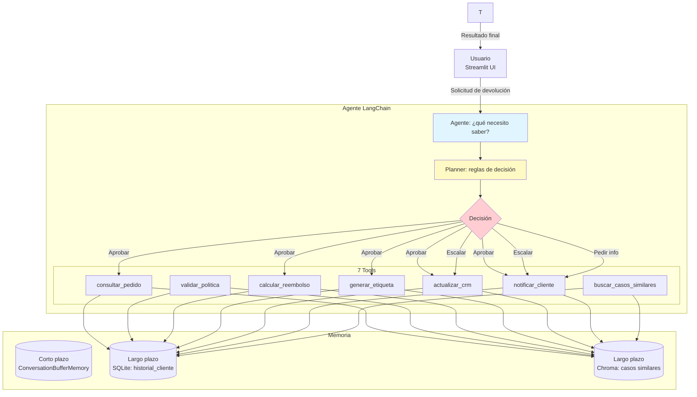

# TechStore Returns Agent

## Descripción del problema

**TechStore Returns Agent** es un agente de IA autónomo que automatiza el proceso de devoluciones de productos en una tienda de tecnología (TechStore). El agente recibe solicitudes de devolución en lenguaje natural, consulta el estado del pedido, valida la política de devolución, aplica reglas de decisión de negocio, ejecuta acciones (reembolso, generación de etiqueta de envío, actualización de CRM, notificación al cliente) y escalar casos cuando corresponde.

El agente está diseñado para operar de forma **autónoma y trazable**, aplicando 6 reglas de decisión en orden estricto de prioridad, con memoria corta y largo plazo, y memoria semántica mediante Chroma (RAG).

---

## Diagrama de orquestación



---

## Las 7 tools del agente

| Tool | Entrada | Salida | Regla que activa |
|------|---------|--------|------------------|
| `consultar_pedido` | `pedido_id: str` | dict con pedido | siempre |
| `validar_politica` | `pedido_id`, `motivo` | `{elegible, razon}` | elegibilidad |
| `calcular_reembolso` | `pedido_id`, `tipo` | `{monto, moneda}` | reembolso |
| `generar_etiqueta` | `pedido_id` | `{codigo, url}` | logística |
| `actualizar_crm` | `pedido_id`, `estado` | `{ok}` | trazabilidad |
| `notificar_cliente` | `cliente_id`, `mensaje` | `{ok}` | comunicación |
| `buscar_casos_similares` | `texto` | `list[dict]` | RAG semántica |

---

## Instalación y ejecución

### Requisitos previos
- Python 3.10+
- Cuenta de Google con API key de Gemini (obtener en [AI Studio](https://aistudio.google.com/apikey))

### Instalación paso a paso

```bash
# 1. Clonar el repositorio
git clone https://github.com/RDTmc/techstore-returns-agent-rdmunoz.git
cd techstore-returns-agent-rdmunoz

# 2. Crear y activar entorno virtual
python -m venv .venv
.venv\Scripts\Activate.ps1   # Windows PowerShell
# o
source .venv/bin/activate    # Mac/Linux

# 3. Instalar dependencias
pip install -r requirements.txt

# 4. Configurar variables de entorno
cp .env.example .env
# Editar .env y agregar GOOGLE_API_KEY y LLM_MODEL=gemini-3.8-flash

# 5. Generar datos mock
python scripts/generate_mock_data.py

# 6. Cargar datos a SQLite
python -m scripts.seed_data

# 7. Indexar políticas y casos en Chroma (memoria semántica)
python scripts/index_politicas.py

# 8. Ejecutar el agente (Interfaz Streamlit)
streamlit run app.py
```

---

## Ejemplos de uso

Una vez ejecutando la interfaz Streamlit, prueba los siguientes escenarios:

| Pedido | Esperado | Acción |
|--------|----------|--------|
| `PED-001` | Cliente recurrente, monto bajo | `aprobar_preferente` |
| `PED-015` | Fuera de plazo (45 días) | `escalar` |
| `PED-022` | Monto alto ($250.000) | `solicitar_aprobacion` |

---

## Declaración de uso de IA

| Herramienta | Uso | Validado por |
|-------------|-----|--------------|
| Gemini 3.8 Flash | Motor del agente (razonamiento, decisión) | Estudiante |
| LangChain | Orquestación de herramientas y planner | Estudiante |
| ChromaDB | Memoria semántica (RAG) | Estudiante |
| Streamlit | Interfaz de usuario | Estudiante |
| IA (chat) | Asistencia en redacción de código y documentación | Estudiante |

Las conclusiones y justificaciones técnicas fueron redactadas por el estudiante sin asistencia de IA.

---

## Referencias

- LangChain Documentation. (2026). *LangChain 0.3 Documentation*. https://python.langchain.com/
- Google AI. (2026). *Gemini API Documentation*. https://ai.google.dev/gemini-api/docs
- ChromaDB. (2026). *ChromaDB Documentation*. https://docs.trychroma.com/
- Streamlit. (2026). *Streamlit Documentation*. https://docs.streamlit.io/
- sentence-transformers. (2026). *Sentence Transformers Documentation*. https://www.sbert.net/
