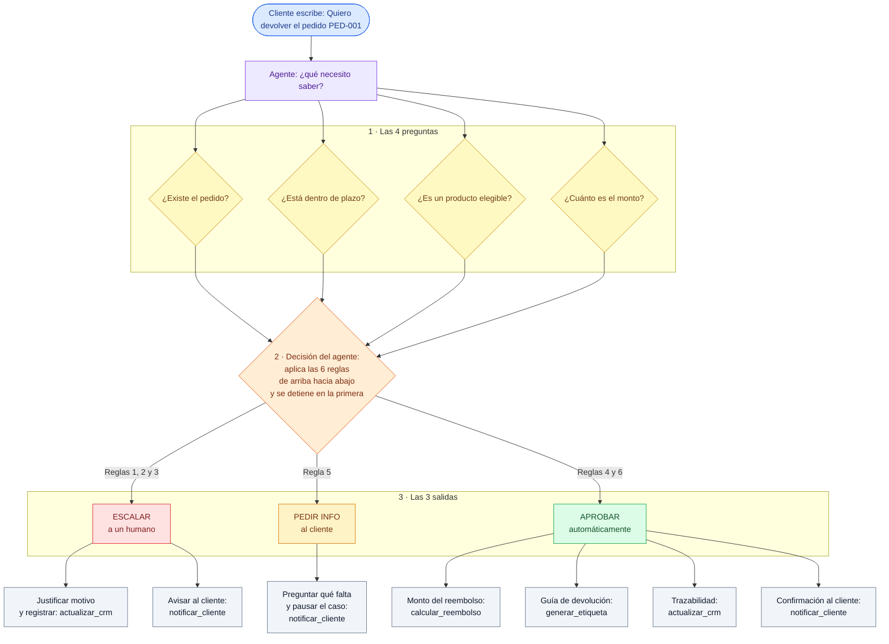

# Flujo del agente — Diagrama (Paso 1.1)

> Referencia digital del diagrama dibujado a mano. Es la **misma lógica de la
> guía** pero con las reglas y tools explicitadas para que sea más explicativo.

## Cómo verlo

| Dónde | Cómo |
|---|---|
| **GitHub** | Después del push, al abrir este archivo se renderiza solo |
| **mermaid.live** | Copiar el código del bloque y pegarlo (exporta PNG/SVG) |
| **draw.io** | `Arrange → Insert → Mermaid` → pegar → `Insert` → queda como formas editables para darle diseño propio |

## Diagrama

## Tabla de apoyo: regla → salida → tools

| Regla | Condición | Salida | Tools que se ejecutan |
|---|---|---|---|
| 1 | No elegible (plazo/producto) | ESCALAR | actualizar_crm, notificar_cliente |
| 2 | Monto > $100.000 | ESCALAR (aprobación) | actualizar_crm, notificar_cliente |
| 3 | ≥3 devoluciones en 90 días | ESCALAR (fraude) | actualizar_crm, notificar_cliente |
| 4 | Cliente recurrente y monto < $50.000 | APROBAR | calcular_reembolso, generar_etiqueta, actualizar_crm, notificar_cliente |
| 5 | Falta comprobante o descripción | PEDIR INFO | notificar_cliente |
| 6 | Caso estándar | APROBAR | calcular_reembolso, generar_etiqueta, actualizar_crm, notificar_cliente |

Siempre, como primer paso: **consultar_pedido**. Y para enriquecer la decisión:
**validar_politica** + **buscar_casos_similares** (RAG).
