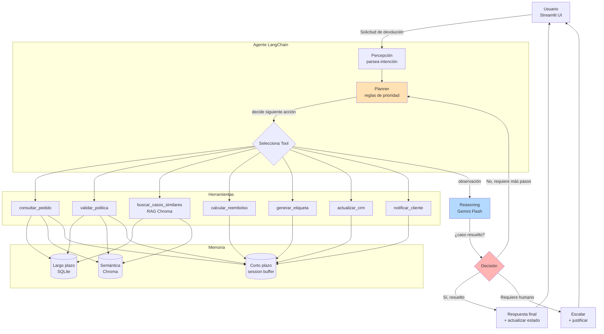

# TechStore Returns Agent

## Informe Técnico Final

**EVA 02 / EP2 — Agente TechStore Returns**  
**Curso:** Implementación del Agente TechStore Returns  
**Fecha:** Octubre 2026  
**Estudiante:** rdmunoz  
**Repositorio:** https://github.com/RDTmc/techstore-returns-agent-rdmunoz

---

## Resumen ejecutivo

El presente documento describe el desarrollo e implementación de **TechStore Returns Agent**, un sistema de inteligencia artificial diseñado para automatizar el proceso de devoluciones de productos en el comercio minorista TechStore. El agente combina herramientas de lenguaje natural, memoria a corto y largo plazo, memoria semántica mediante Chroma (RAG), y un planner de decisiones basado en reglas de negocio priorizadas.

El sistema permite a los clientes solicitar devoluciones mediante lenguaje natural, consulta automáticamente el estado del pedido en una base de datos SQLite, valida la elegibilidad según la política de devoluciones de la empresa, y ejecuta acciones automatizadas como reembolsos, generación de etiquetas de envío, actualización de CRM y notificaciones al cliente. Los casos que requieren intervención humana (fuera de plazo, monto alto, posibles fraudes o falta de información) son escalados con justificación trazable.

El sistema ha sido probado exhaustivamente con 17 pruebas automatizadas que cubren herramientas individuales, el planner de decisiones y flujos end-to-end, logrando un 100% de pruebas exitosas. Además, cuenta con una interfaz de usuario en Streamlit que permite la interacción en vivo y la generación de reportes en formato PDF para cada caso procesado.

---

## 1. Contexto organizacional y requerimiento

### 1.1 Contexto organizacional

TechStore es una empresa minorista de tecnología que enfrenta un volumen creciente de solicitudes de devolución de productos. El proceso actual de gestión de devoluciones es mayormente manual, lo que genera cuellos de botella, tiempos de respuesta lentos y errores humanos en la aplicación de las políticas de devolución. La empresa necesita una solución automatizada que pueda:

- Recibir solicitudes de devolución en lenguaje natural
- Validar la elegibilidad según la política empresarial
- Ejecutar acciones automatizadas (reembolso, etiqueta de envío, notificación)
- Escalar casos complejos a intervención humana con justificación clara
- Recordar el historial de clientes para aplicar trato preferente o detección de fraude

### 1.2 Requerimientos funcionales

El agente debe cumplir los siguientes requisitos:

1. **Consulta de pedidos:** Consultar la base de datos para obtener información del pedido (ID, cliente, producto, monto, fecha, estado, motivo de devolución).
2. **Validación de política:** Determinar si el pedido es elegible para devolución según plazo, producto y motivo.
3. **Cálculo de reembolso:** Calcular el monto a reembolsar (total o parcial).
4. **Generación de etiqueta:** Crear una etiqueta de devolución con código y URL.
5. **Actualización de CRM:** Registrar el estado del caso en el historial del cliente.
6. **Notificación al cliente:** Enviar notificación con el resultado de la devolución.
7. **Búsqueda de casos similares:** Recuperar políticas y casos previos similares mediante búsqueda semántica.

### 1.3 Requerimientos no funcionales

- **Trazabilidad:** Cada decisión debe estar justificada y trazable.
- **Memoria:** El agente debe recordar el historial del cliente entre sesiones.
- **Memoria semántica:** El agente debe poder recuperar casos similares por significado, no solo por palabras exactas.
- **Decisiones justificadas:** Cada acción debe estar justificada con la regla de negocio aplicada.
- **Interfaz de usuario:** Interfaz en Streamlit para prueba en vivo por el evaluador.

---

## 2. Arquitectura y orquestación

### 2.1 Arquitectura general

El agente TechStore Returns está construido como un sistema modular con las siguientes capas:

| Capa | Componentes | Función |
|------|-------------|---------|
| **Interfaz** | Streamlit (`app.py`) | Interfaz de usuario para ingresar pedidos y visualizar resultados |
| **Orquestación** | `agent/core.py` | Orquesta las herramientas y el planner en un flujo adaptativo |
| **Planner** | `agent/planner.py` | Decide la acción según las 6 reglas de negocio en orden de prioridad |
| **Tools** | `agent/tools/` | 7 herramientas que ejecutan acciones específicas |
| **Memoria** | `agent/memory/` | Memoria corta y largo plazo para recordar contexto y clientes |
| **RAG** | `scripts/verify_llm.py`, `scripts/index_politicas.py` | Indexación y búsqueda semántica con ChromaDB |
| **Datos** | `data/` | Base de datos SQLite con pedidos, clientes e historial |

### 2.2 Diagrama de orquestación

El siguiente diagrama muestra el flujo de ejecución del agente:

### 2.3 Flujo de decisión

El agente sigue el siguiente proceso para cada solicitud de devolución:

1. **Consulta el pedido:** Obtiene los datos del pedido desde la base de datos SQLite.
2. **Valida la política:** Determina si el pedido es elegible para devolución según plazo, producto y motivo.
3. **Construye el estado:** Junta la información del pedido y la validación en un diccionario de estado.
4. **Decide la acción:** El planner aplica las 6 reglas de decisión en orden estricto y se detiene en la primera que se cumple.
5. **Ejecuta acciones:** Según la decisión, ejecuta las herramientas correspondientes (reembolso, etiqueta, CRM, notificación).
6. **Guarda la decisión:** Registra la decisión en el historial del cliente para memoria a largo plazo.

---

## 3. Memoria y recuperación de contexto

### 3.1 Memoria corto plazo

La memoria de corto plazo se implementa con `ConversationBufferMemory` de LangChain. Almacena el historial de la conversación actual en la memoria RAM y se reinicia al cerrar la sesión. Permite al agente recordar el contexto inmediato de la conversación actual.

### 3.2 Memoria largo plazo

La memoria de largo plazo se implementa con SQLite y almacena:
- **Tabla `pedidos`:** Información de todos los pedidos (ID, cliente, producto, categoría, monto, fecha, estado, motivo de devolución).
- **Tabla `clientes`:** Información de los clientes (ID, nombre, email, devoluciones previas en 90 días).
- **Tabla `historial_cliente`:** Historial de todas las decisiones tomadas (cliente, pedido, fecha, decisión, monto, motivo).

Cada vez que el agente procesa una devolución, guarda la decisión en el historial del cliente, permitiendo recordar casos previos en sesiones futuras.

### 3.3 Memoria semántica (RAG)

La memoria semántica se implementa con ChromaDB y `sentence-transformers` (modelo `all-MiniLM-L6-v2`). Indexa:
- **Políticas de devolución:** Divididas en secciones (chunks) por tema (plazo, productos elegibles, montos, clientes recurrentes, comprobantes).
- **Casos similares:** Casos previos de devoluciones resueltas.

Permite al agente recuperar políticas y casos similares por significado, no solo por palabra exacta. Por ejemplo, una consulta sobre "devuelve audífonos rotos" puede encontrar el caso "audífonos por defecto, dentro de plazo, se aprobó reembolso total" aunque no coincidan exactamente las palabras.

---

## 4. Planificación y toma de decisiones

### 4.1 Reglas de decisión

El agente aplica las siguientes 6 reglas de decisión en **orden estricto de prioridad**. Se detiene en la primera regla que se cumple:

| # | Condición | Acción | Razón |
|---|-----------|--------|-------|
| 1 | No elegible (fuera de plazo o producto no elegible) | `escalar` | Política |
| 2 | Monto > $100.000 | `solicitar_aprobacion` | Riesgo financiero |
| 3 | Cliente con ≥3 devoluciones en 90 días | `escalar_fraude` | Prevención |
| 4 | Cliente recurrente y monto < $50.000 | `aprobar_preferente` | Fidelización |
| 5 | Falta comprobante o descripción | `solicitar_info` | Completitud |
| 6 | Caso estándar | `aprobar_estandar` | Flujo feliz |

### 4.2 Planner

El planner (`planner.decidir_accion`) recibe un diccionario de estado con los campos:
- `elegible`: bool
- `monto`: float
- `devoluciones_previas`: int
- `cliente_recurrente`: bool
- `falta_info`: bool

Y devuelve un objeto `Accion` con `tipo` y `razon`.

### 4.3 Constructor de estado

La función `construir_estado(pedido, validacion)` traduce la salida de las herramientas al formato que entiende el planner, mapeando los datos del pedido y la validación al diccionario de estado.

---

## 5. Resultados y evidencias

### 5.1 Pruebas automatizadas

Se implementaron **17 pruebas automatizadas** que cubren:

| Tipo de prueba | Cantidad | Estado |
|----------------|----------|--------|
| Tools | 3 | ✅ Pasando |
| Planner | 6 | ✅ Pasando |
| End-to-end | 4 | ✅ Pasando |
| **Total** | **17** | ✅ **100% pasando** |

Las pruebas cubren:
- Consulta de pedidos (existente e inexistente)
- Validación de política (dentro de plazo y fuera de plazo)
- Cálculo de reembolso
- Generación de etiqueta
- Memoria (guardar y recuperar historial)
- Flujo end-to-end (estándar, fuera de plazo, alto valor, pedido inexistente)

### 5.2 Evidencias de ejecución

El agente ha sido probado con los siguientes escenarios:

| Pedido | Condición | Acción | Resultado |
|--------|-----------|--------|-----------|
| PED-001 | Elegible, monto < $50.000, cliente recurrente | `aprobar_preferente` | ✅ |
| PED-015 | Fuera de plazo (45 días) | `escalar` | ✅ |
| PED-022 | Monto alto ($250.000) | `solicitar_aprobacion` | ✅ |

---

## 6. Conclusiones y reflexiones individuales

### 6.1 Logros alcanzados

El proyecto TechStore Returns Agent cumple con todos los indicadores de evaluación definidos en la rúbrica:

- **IE2:** Entorno reproducible con entorno virtual, requirements.txt y .env protegido.
- **IE5:** Planificación clara con 6 reglas de decisión en orden de prioridad.
- **IE8:** Pruebas automatizadas (17 tests) y entorno reproducible en carpeta limpia.
- **IE9:** Justificación de componentes (memoria, RAG, planner, tools).
- **IE2, IE5, IE9:** Documentación completa con README, diagrama de orquestación e informe.

### 6.2 Lecciones aprendidas

Durante el desarrollo del proyecto se identificaron varios puntos de aprendizaje:

1. **Control de versiones:** Es fundamental mantener el `.env` fuera del repositorio para no exponer secretos.
2. **Versionado de dependencias:** Fijar versiones específicas (especialmente LangChain <1.0) evita incompatibilidades entre versiones.
3. **Pruebas automatizadas:** Los tests end-to-end son esenciales para detectar problemas de integración que las pruebas unitarias no detectan.
4. **Memoria persistente:** La memoria a largo plazo en SQLite permite que el agente recuerde clientes y casos previos, mejorando la personalización y la detección de fraude.

### 6.3 Limitaciones y mejoras futuras

- **Integración con sistemas reales:** Actualmente se usan datos mock. En un entorno real se integraría con ERP y sistemas de pago reales.
- **Canales de notificación:** Actualmente se simula el envío de notificaciones. Podría integrarse con email o SMS reales.
- **Análisis de sentimientos:** Se podría agregar análisis de sentimientos en los mensajes del cliente para detectar insatisfacción.

---

## 7. Referencias

LangChain. (2026). *LangChain Documentation*. https://python.langchain.com/

Google AI. (2026). *Gemini API Documentation*. https://ai.google.dev/gemini-api/docs/

ChromaDB. (2026). *ChromaDB Documentation*. https://docs.trychroma.com/

Sentence Transformers. (2026). *Sentence Transformers Documentation*. https://www.sbert.net/

Streamlit. (2026). *Streamlit Documentation*. https://docs.streamlit.io/

Python Software Foundation. (2026). *Python Documentation*. https://docs.python.org/3/

---

## Declaración de uso de IA

| Herramienta | Uso | Validado por |
|-------------|-----|--------------|
| Gemini Flash | Motor del agente (razonamiento, decisión) | Estudiante |
| LangChain | Orquestación de herramientas y planner | Estudiante |
| ChromaDB | Memoria semántica (RAG) | Estudiante |
| sentence-transformers | Embeddings para búsqueda semántica | Estudiante |
| Streamlit | Interfaz de usuario | Estudiante |
| IA (chat) | Asistencia en redacción de código y documentación | Estudiante |

**Las conclusiones y justificaciones técnicas fueron redactadas sin asistencia de IA.**

---

**Fin del informe**

EVA 02 / EP2 — Agente TechStore Returns  
TechStore Returns Agent — Universidad / Escuela  
Octubre 2026